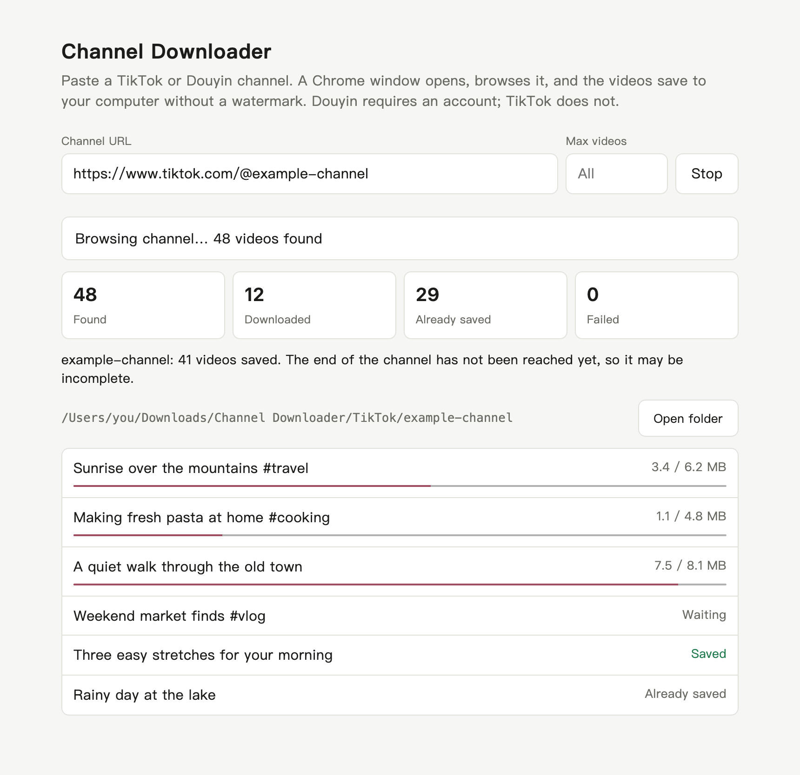
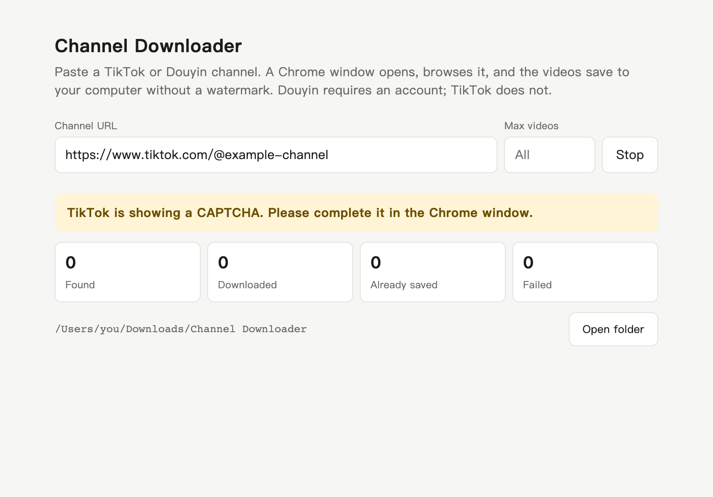
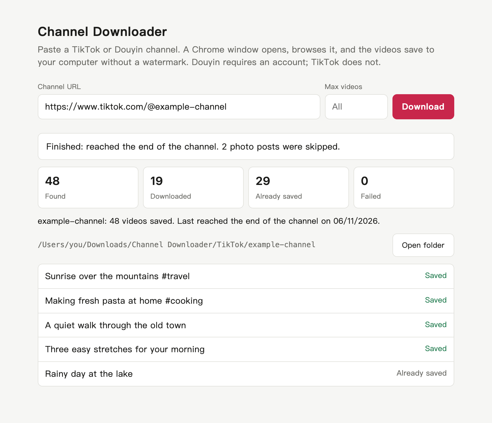

# Channel Downloader

Paste a TikTok or Douyin channel link. A Chrome window opens and browses the channel, and its videos save to your computer without the platform's download watermark.

It runs entirely on your own computer. There is no server, account or tracking.

<picture>
  <source media="(prefers-color-scheme: dark)" srcset="docs/images/downloading-dark.png">
  
</picture>

*Screenshots use sample data.*

## Status

| Feature | State |
|---|---|
| TikTok on macOS | Tested on a real channel, no login needed |
| Douyin | Built, but real downloads are **not tested yet**. Douyin needs a logged-in account to list a channel |
| Link Grabber for Douyin | Tested on a real channel on macOS with an Android emulator, no login needed. It gets only the videos Douyin shows logged-out visitors |
| Windows and Linux | Written to work, but **not tested yet** |

Sites change often, so a site update can break this app. If it does, please open an issue.

## Features

- Downloads a whole channel, or a set number of new videos
- Picks the highest-resolution stream that has no download watermark
- Downloads 3 videos at a time, with live progress
- Skips videos you already have, so you can run a channel again to pick up new ones
- Retries failed videos the next time you run the channel
- Remembers whether a run reached the end of the channel
- Waits for you when a CAPTCHA or login appears

## Requirements

- [Node.js](https://nodejs.org) 20 or newer
- [Google Chrome](https://www.google.com/chrome/)

## Install

```bash
git clone https://github.com/sinawatra/Channel-Downloader.git
```

```bash
cd Channel-Downloader
```

```bash
npm install
```

## Use it

1. Start the app:

   ```bash
   npm start
   ```

2. Open http://127.0.0.1:4599 in your browser.
3. Paste a channel link, such as `https://www.tiktok.com/@name` or `https://www.douyin.com/user/MS4w...`.
4. Optionally set **Max videos**. It counts only new downloads, and leaving it empty downloads the whole channel.
5. Click **Download**. A separate Chrome window opens, so leave it open until the run finishes.

If a CAPTCHA or login appears, the page asks you to complete it yourself in that Chrome window. The run then continues on its own. Press **Stop** at any time; finished videos are kept.



When a run ends, the page tells you whether it reached the end of the channel and how many videos you have saved.



### Where videos are saved

```
~/Downloads/Channel Downloader/
  TikTok/
    channel-name/
      2025-10-07_7558280957363555639_Video title.mp4
      .channel.json
```

`.channel.json` is the app's record of the channel. It's hidden on macOS and Linux, and you can leave it alone. A channel keeps its folder even if it's renamed.

## Link Grabber (Douyin without an account)

Douyin doesn't let this app download videos without a login. The **Link Grabber** section collects a channel's video links instead, using the Douyin app on an Android emulator. It only gives you links and doesn't download anything.

You also need:

- [Android Studio](https://developer.android.com/studio), with an Android emulator
- The Douyin app installed on the emulator. Open it once and accept its first-run prompts yourself

To use it:

1. **Start the emulator** from Android Studio's Device Manager. The grabber doesn't start it for you, and it can't run without it.
2. Paste a channel link, or the whole share message from Douyin, into **Douyin channel link**. You don't need to open the channel yourself.
3. Click **Grab links**. It takes about 10 seconds per video.
4. Click **Copy all** when it finishes.

While it runs, don't touch the emulator or copy anything on your computer. It reads each link from the clipboard, which the emulator shares with your computer.

If Douyin shows a login screen, the page asks you to close it with the X in the emulator, or press **Stop**. Links already collected are kept.

**You may not get every video.** Douyin shows logged-out visitors only part of a channel and hides the newest videos, so the page tells you if the list ended early. The grabber relies on the Douyin app's screen layout, so an app update can break it.

## Good to know

- **Deleted videos come back:** the app treats any video that isn't in the folder as new, so running the channel again downloads any videos you deleted.
- **Photo posts are skipped:** only videos are downloaded, and the page shows how many photo posts were skipped.
- **Labels inside the video stay:** the app avoids the platform's download watermark, but it can't remove anything that's part of the picture, such as a creator's logo or an "AI-generated" label.
- **Some videos may be unavailable:** a video is marked **Unavailable** if the site offers no watermark-free version. The app doesn't fall back to a watermarked copy.

## Settings

Set these as environment variables when starting the app:

| Variable | Default | Purpose |
|---|---|---|
| `PORT` | `4599` | Port for the local page |
| `OUT_DIR` | `~/Downloads/Channel Downloader` | Where videos are saved |
| `PROFILE_DIR` | `.browser-profile` in the project | Where the app's Chrome profile is kept |
| `BROWSER_CHANNEL` | `chrome` | Which installed browser to use, such as `msedge` (untested) |

For example:

```bash
OUT_DIR=~/Movies/Channels npm start
```

## Privacy and security

The app uses its own Chrome profile, separate from your normal Chrome. It stays on your computer in `.browser-profile`, and any logins you complete in that window are saved there.

**Never share, upload or commit `.browser-profile`.** It can contain login cookies that give access to your accounts. The project's `.gitignore` excludes it, but be careful if you copy the folder or zip the project.

The local page only accepts requests from your own computer.

## Use it responsibly

Videos belong to their creators. Only download videos you own or have permission to save, and don't re-upload other people's videos or use them commercially without permission. Removing or avoiding a watermark doesn't change who owns a video, and this kind of tool may be against a platform's terms. You're responsible for how you use it.

The app doesn't bypass logins or solve CAPTCHAs. Those stay with you.

If you paste grabbed links into another download site, check that site's terms first. Some don't allow automated or bulk use.

## Troubleshooting

| What you see | What to do |
|---|---|
| Chrome doesn't open, or an error mentions the browser or profile | Check that Chrome is installed. Close any Chrome window left from an earlier run, then try again |
| "only lists this channel for logged-in accounts" | Log in in the Chrome window, or press **Stop** if you have no account |
| "No new videos yet" | Look in the Chrome window for a prompt you need to complete |
| "the site refused" or "stopped returning videos" | Wait a while and run the channel again. Saved videos are skipped |
| "may be incomplete" | Run the channel again until the page says it reached the end |
| The port is already in use | Start with another port: `PORT=4600 npm start` |
| "Could not run adb" | Install Android Studio, or set `ANDROID_HOME` to your Android SDK folder |
| "No Android emulator is running" | Start an emulator in Android Studio, then try again |
| "several videos in a row gave no link" | Check that the emulator's clipboard sharing is on and that nothing is covering Douyin, then run it again |

## Development

```bash
npm test
```

Runs the unit tests, without a browser.

```bash
npm run test:browser
```

Runs the real crawler against a local fake site. It opens Chrome windows and takes about 2 minutes.

### Project layout

```
src/
  main.js          Starts the app
  config.js        Settings and default locations
  host.js          Operating-system actions, such as opening a folder
  server.js        The local web server
  job.js           Runs one channel: the crawl plus the downloads
  crawler.js       Controls Chrome and reads the channel's video lists
  crawlPolicy.js   Decides the next step: wait, scroll, reload or finish
  downloader.js    Saves video files
  channelStore.js  The saved record for each channel
  files.js         Safe file and folder names
  linkGrabber.js   Collects share links from the Douyin app
  android.js       Controls the Android emulator through adb
  platforms/       One file per site
public/index.html  The page you use
test/              Unit tests
integration/       Browser test against a fake site
```

### Adding a site

1. Add a file in `src/platforms/`, using `tiktok.js` as the model.
2. List it in `src/platforms/index.js`.
3. Add tests to `test/platforms.test.js`, including one proving that watermarked links are never used.

## License

[MIT](LICENSE)
